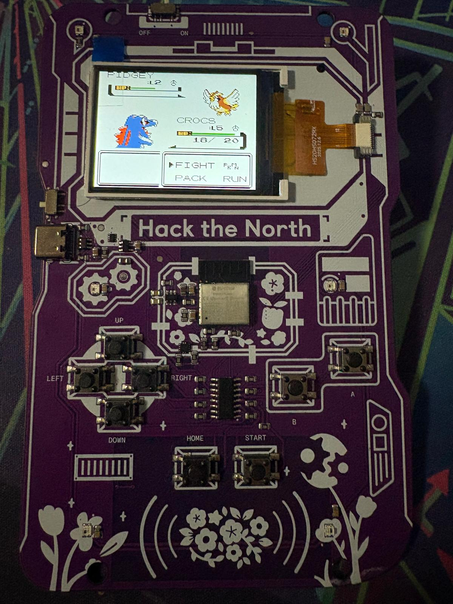
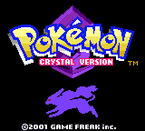
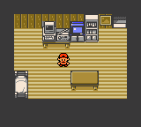

# Crystal-esp32

[](https://github.com/Abish-27/Crystal-esp32/actions/workflows/ci.yml)

An experiment by [Abish Kulkarni](https://github.com/Abish-27): turning a Hack the North 2026 badge into a standalone Game Boy Color handheld, with full-screen graphics, persistent saves, and game-driven RGB LEDs.

<p align="center">
  
</p>

Pokémon Crystal running on the physical badge during a battle.

<p align="center">
  
  &nbsp;&nbsp;
  
</p>

These are native 160×144 USB framebuffer captures. The physical LCD scales the picture to 320×240.

The emulator core is an existing Peanut-GB CGB fork. This project supplies the badge integration: LCD and button handling, asynchronous display transfers, flash-save storage, USB diagnostics, and Crystal-specific LED hooks.

## What works

- Full-screen RGB565 graphics on the badge's ST7789 LCD.
- Stable framebuffer snapshots and SPI DMA transfers in a separate display task.
- D-pad, A/B, START, and HOME as Game Boy SELECT.
- Two alternating CRC-checked cartridge-save slots, with periodic dirty-RAM commits.
- Dim RGB feedback for player/opponent HP loss, catches, saves, and pause.
- USB screenshots, input injection, status, and display diagnostics.

In recorded bedroom tests on the physical ESP32-C3 at **160 MHz**, emulation reached **59.73 FPS**, with **19.88–19.98 completed LCD updates/sec**, **95,840 bytes free heap**, and zero reported core errors. These measurements describe that scene on USB power, not every area of the game. In-game SAVE → restart → CONTINUE was verified.

## Current limits

There is no sound or clock advancement while powered off. This standalone firmware replaces the stock launcher while installed. Complete-game compatibility, real battle/capture LED feedback, AA-powered operation, and physical shortcut/debounce behavior need broader testing. The original firmware's restore procedure has not been exercised. See [validation](docs/VALIDATION.md).

**No game ROM, game save, flash dump, badge identity/contact data, or prebuilt firmware image is included.** Supply your own lawfully obtained Crystal v1.1 ROM. A supported ROM fingerprint and the LED profile are documented in [building and flashing](docs/BUILDING.md).

## Get started

1. Use the **Hack the North 2026 ESP32-C3 badge with 4 MiB flash**. This is not a generic ESP32 wiring layout.
2. Install and activate **ESP-IDF v5.5.3**.
3. Build from the repository root:

   ```sh
   idf.py set-target esp32c3
   bash tools/build.sh
   ```

4. Follow [the backup and deployment guide](docs/BUILDING.md) before installing. Use `tools/flash.py`, which prints a validated plan by default. Its `--flash` flag performs writes. Generic `idf.py flash` is not the documented deployment path because it also writes the bootloader.

For local host tests without any commercial ROM:

```sh
bash tools/test.sh
```

## Controls

| Badge control | Action |
|---|---|
| D-pad, A, B, START | Corresponding Game Boy input |
| HOME | Game Boy SELECT |
| HOME + START | Commit cartridge RAM and toggle pause |
| HOME + B | Toggle dim LEDs on/off |
| HOME + RIGHT | Cycle display request interval: 2/3/4 game frames |

**Use Crystal's own SAVE menu before committing or powering off.** A cartridge-RAM commit is not an emulator save-state. Full-screen stretch is the default; size changes are USB-only.

## How it fits together

See [architecture and hardware](docs/ARCHITECTURE.md), [USB commands](docs/USB.md), and [host tests](host/README.md).

```text
main/       Badge drivers, emulator wrapper, LED event detection
vendor/     Pinned Peanut CGB header and local-change notes
host/       Host harness, generated-cartridge tests, input scripts
tools/      Build, validation, guarded flashing, and USB console
tests/      Deployment validation tests (no device access)
docs/       Reproduction, measurements, and development notes
```

## Credits and license

Built on the [Hack the North badge firmware](https://github.com/hackthenorth/badge-firmware), [badge hardware](https://github.com/hackthenorth/badge-hardware), and [PicoPlus-devel/pico-peanutGB](https://github.com/PicoPlus-devel/pico-peanutGB). Crystal event addresses were checked against [pret/pokecrystal](https://github.com/pret/pokecrystal).

Project integration is distributed under **GPL-3.0**; the vendored emulator retains its **MIT** notice. See [LICENSE](LICENSE) and [THIRD_PARTY_NOTICES.md](THIRD_PARTY_NOTICES.md) for provenance and modifications. Pokémon and game assets belong to their respective owners. This is an independent project and is not affiliated with Nintendo, Game Freak, or The Pokémon Company.
